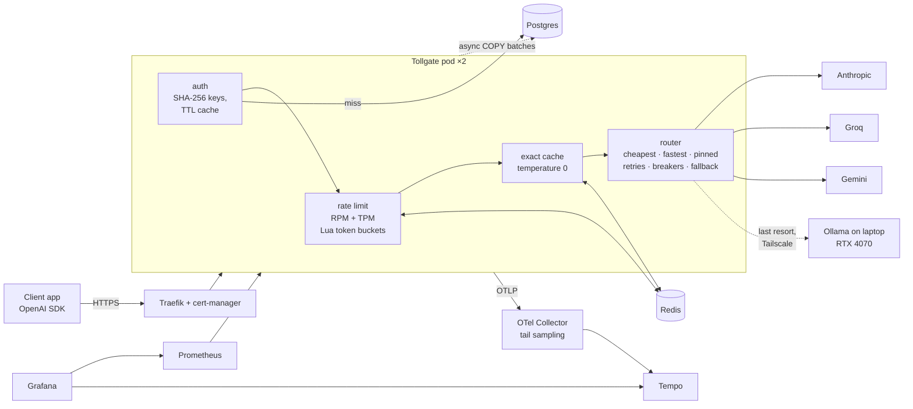

# Tollgate

**An OpenAI-compatible LLM gateway in Go.** One endpoint in front of Anthropic, Groq, Gemini and a local Ollama, with virtual keys, Redis rate limits, response caching, automatic fallback, a spend ledger, and full observability. **0.2 ms p50 gateway overhead at 4,000 rps on 2 CPUs.**

[](https://github.com/krishbansalofficial/tollgate/actions/workflows/ci.yml)


-brightgreen)

Point any OpenAI SDK at it by changing `base_url`:

```python
client = OpenAI(base_url="https://<your-host>/v1", api_key="tg_...")
client.chat.completions.create(model="tollgate/cheapest", messages=[...], stream=True)
```

## Architecture



**Request path:**
1. **Auth:** the key is hashed and looked up in a 30 s in-process cache, falling back to Postgres.
2. **Rate limit:** one atomic Lua script in Redis checks and reserves both requests/min and tokens/min.
3. **Cache:** an exact-match lookup, for `temperature: 0` requests only.
4. **Router:** picks providers by policy, retries with full jitter under a retry budget, and skips providers whose circuit breaker is open.
5. **Respond:** the response is written in one write. SSE streams are flushed per chunk, and TTFT is measured.
6. **Bookkeeping, off the hot path:** the token reservation is reconciled with real usage, the cache is filled, a ledger row goes into a buffered channel, and metrics and spans are recorded.

More detail: [docs/DESIGN.md](docs/DESIGN.md) · [ADRs](docs/adr/README.md).

## Real traffic

**Live at [tollg.duckdns.org](https://tollg.duckdns.org)** since 2026-11-27: one Azure ARM VM (2 vCPU, 4 GB) running k3s, with Argo CD, a Let's Encrypt certificate and the full observability stack.

So far the only traffic is the deployment's own smoke tests. These are the ledger's numbers on 2026-11-27, read straight from `usage_events`:

| Provider | Requests | Tokens in / out | Cost | p50 upstream latency |
|---|---|---|---|---|
| Groq (gpt-oss-20b, 120b) | 8 | 628 / 1,622 | $0.000594 | 487 ms |
| Anthropic (Haiku 5.5, Sonnet 5.5) | 2 | 36 / 18 | $0.000142 | 786 ms |
| Gemini (3.5 Flash-Lite) | 1 | 9 / 7 | $0.000020 | 565 ms |
| Cache hit | 1 | 79 / 199 | $0 (saved $0.000066) | 0 ms |
| Rejected (404 unknown model, 401 bad key, 502) | 16 | 0 | $0 | |

**Gateway overhead in production: 1.0 ms p50** (total latency minus upstream time, over the 11 routed requests). That is higher than the 0.2 ms benchmark below, most likely because so few requests mostly hit cold connections and a cold auth cache.

Apps routed through Tollgate and a Grafana screenshot will be added here once real apps send traffic.

## Performance

Gateway overhead against a mock upstream with a fixed 50 ms latency, so provider latency doesn't hide the gateway's own cost. The gateway is **capped at 2 CPUs**, the production node's budget. Each request does real auth, two Redis Lua scripts, routing, a ledger write and a trace. Load is open-model (k6 `constant-arrival-rate`), 45 s per step.

| rps | errors | client p50 | client p95 | client p99 | **gateway overhead p50** | **gateway overhead p99** |
|---:|---:|---:|---:|---:|---:|---:|
| 2,000 | 0% | 51.1 ms | 51.8 ms | 61.4 ms | 0.19 ms | 0.7 ms |
| 3,000 | 0% | 51.1 ms | 52.3 ms | 63.8 ms | 0.19 ms | 1.2 ms |
| **4,000 (knee)** | 0% | 51.1 ms | 54.7 ms | 72.1 ms | 0.20 ms | **4.1 ms** |
| 5,000 | 0% | 51.3 ms | 61.3 ms | 81.5 ms | 0.21 ms | 10.7 ms |
| 3,000, cache hits | 0% | 0.5 ms | 0.8 ms | 3.9 ms | 0.38 ms | 1.5 ms |

**What profiling found:** write syscalls were 26% of CPU, partly from an explicit flush on every response. The fix sends each response in one write and moves bookkeeping off the request goroutine. That moved the 2-CPU knee from **~2,500 to ~4,000 rps** and cut client p99 at 3,000 rps from **104.9 to 63.8 ms**.

Hardware, methodology, raw data, CPU profiles, and a caveat about how the overhead metric changed with the fix are in [loadtest/RESULTS.md](loadtest/RESULTS.md).

## Design decisions and tradeoffs

**Token bucket, not a sliding window.**
- A sliding-window log is exact but stores every request timestamp per key.
- A fixed window lets a client send 2× the limit across a window boundary.
- A token bucket is O(1) state per key and allows bounded bursts, which suits LLM traffic.
- Tokens/min is enforced by reserving `prompt estimate + max_tokens` up front, then refunding or charging the difference once real usage is known. A bucket can go into debt, so the *next* request waits instead of this one failing after the tokens were already spent.
- [ADR 0003](docs/adr/0003-token-bucket-in-redis-lua.md).

**Why Lua.**
- Separate commands (read, refill, decrement) race between replicas: two pods both see "1 left" and both admit.
- Redis runs a script without interleaving other commands, so check-and-decrement is atomic across pods in a single round trip, with no locks or WATCH retry loops.
- The script uses Redis's own clock, so clock skew between replicas doesn't matter.
- Keys are hash-tagged `{key_id}`, so the script still works on Redis Cluster.
- Proven by a test: 200 goroutines race for a limit of 50, against real Redis, and exactly 50 are admitted.

**Fail open vs fail closed.**
- If Redis is down, the limiter can't decide.
- The default is **fail open**: availability wins, and spend stays bounded by provider-side limits and alerts.
- `TOLLGATE_RATELIMIT_FAIL_MODE=closed` makes the opposite choice.
- Both modes were measured (see failure testing below), and readiness never depends on Redis, so a Redis outage can't remove every pod from service.
- [ADR 0004](docs/adr/0004-fail-open-default.md).

**Asynchronous, lossy-by-design ledger.**
- Handlers do a non-blocking send into a 10,000-row buffer.
- One writer batches by size (500 rows) or time (1 s) and inserts with Postgres `COPY`.
- If Postgres is slow, rows are **dropped and counted**, never queued on the request path.
- Shutdown order: drain HTTP, then flush the ledger, then the spans.
- The cost is losing rows on a hard kill; this is measured in the failure tests.
- [ADR 0007](docs/adr/0007-async-lossy-ledger.md).

**Fail closed where money is involved.**
- Only catalog-priced models can be requested. An unknown model would be served at a recorded cost of $0.
- Client-fault upstream errors (400/404/413/422) are neutral for the circuit breaker, so bad requests can't keep a failing provider "healthy".
- Upstream error messages are relayed to clients only when they don't mention keys, billing or quota.

**What changes at 100× scale.**
- **Redis:** Redis Cluster, keyed by `{key_id}`, plus a local pre-limiter that cuts round trips.
- **Key revocation:** pub/sub invalidation instead of waiting out the TTL.
- **Ledger:** a durable queue (Redpanda) replacing the channel, with ClickHouse or partitioned Postgres for analytics.
- **Breakers and latency averages:** stay per-replica on purpose, since every replica sees the same upstreams.
- **Streaming:** concurrent streams become the limit, so the work shifts to file-descriptor limits and connection pools.
- **Next optimisation already identified:** fold each request's reconcile into the next rate-limit call, removing one Redis round trip per request ([RESULTS.md](loadtest/RESULTS.md#next-bottlenecks)).

## Failure testing

Every scenario was run for real with [`loadtest/chaos.sh`](loadtest/chaos.sh). Full results are in [loadtest/CHAOS.md](loadtest/CHAOS.md).

| Scenario | What the client saw |
|---|---|
| Redis down, fail-open | 20/20 requests succeeded; limits bypassed and logged as degraded |
| Redis down, fail-closed | 20/20 got 503, as configured |
| Primary returns 100% 500s or 100% 429s | 40/40 succeeded via fallback; the breaker opened after about 2 requests |
| Primary returns 30% 500s | 40/40 succeeded: 35 via retries on the primary, 5 via fallback |
| Gateway SIGTERM mid-stream | Stream completed (20/20 chunks + `[DONE]`), ledger row flushed, clean exit in 5.2 s |
| Gateway SIGKILL mid-stream | Stream cut after 8 chunks with no `[DONE]`; that ledger row lost (as designed) |

## Run it locally (one command)

```bash
docker compose up --build
```

That starts the gateway, Postgres, Redis, a mock LLM, the OTel Collector, Tempo, Prometheus and Grafana. Grafana is at http://localhost:3000, with the *Tollgate / Overview* and *Spend* dashboards. Then:

```bash
KEY=$(docker compose run --rm --no-deps tollgate keys create --project dev)
curl localhost:8080/v1/chat/completions -H "Authorization: Bearer $KEY" \
  -d '{"model":"tollgate/mock","messages":[{"role":"user","content":"hello"}]}'
```

Add real providers by putting `GROQ_API_KEY`, `ANTHROPIC_API_KEY` or `GEMINI_API_KEY` in `.env` (see `.env.example`).

Tests:
- `go test ./...` runs the unit tests.
- `go test -race -tags integration ./...` also runs the Postgres and Redis container tests; it needs Docker.

## Deploy

Single-node k3s managed by **Argo CD**. One cloud-agnostic cloud-init module turns any Ubuntu 24.04 VM into the node, so the host is a small per-cloud Terraform env:

| env | VM | cost |
|---|---|---|
| `azure` (current) | Standard_B2pls_v2, ARM64, 2 vCPU / 4 GB | $0: Azure for Students credit (~$25/month of it) |
| `oracle` | A1 Flex, ARM64, 2 OCPU / 12 GB | $0: Always Free; validation refuses to exceed the caps |
| `hetzner` | CAX11, ARM64, 2 vCPU / 4 GB | ~€4/month |

1. `terraform apply` in `infra/terraform/envs/<env>`.
2. `infra/bootstrap.sh ubuntu@<ip>` installs Argo CD and points it at `deploy/` (public repo, so no credentials).
3. `scripts/seal-secrets.sh ubuntu@<ip>` encrypts secrets with Sealed Secrets; commit the output.
4. From then on, **every merge to main deploys itself**:
   1. CI runs lint, `go test -race`, Terraform validate and kustomize build.
   2. It builds the multi-arch image and pushes it once to GHCR.
   3. Trivy and the SBOM run on that exact digest.
   4. CI pins the digest on a bot-owned `deploy` branch (the built commit plus one pin commit), and Argo CD rolls it out. `main` only ever has human commits.

Full runbook for each env, plus Ollama over Tailscale: [docs/DEPLOY.md](docs/DEPLOY.md).

## Limitations and roadmap

**Known limitations:**
- **No real apps yet:** the gateway is live, but only smoke-test traffic has gone through it so far.
- **Anthropic sampling:** temperature and top_p are not forwarded. API version 2026-10-21 rejects them.
- **Tools:** tool calling is passed through only to OpenAI-compatible providers; the Anthropic and Gemini adapters reject tools.
- **Streaming and cache:** streams are never cached.
- **Token estimates:** prompt tokens are estimated as bytes / 4, only to size the rate-limit reservation. Real usage reconciles it.
- **Ledger durability:** a hard kill loses rows still buffered in memory.
- **Revocation latency:** a revoked key keeps working for up to 30 s, the key-cache TTL.
- **Alerting:** alerts show up in Prometheus and Grafana, but there's no Alertmanager, to keep hosting at $0.

**Roadmap:**
- [x] Live, with ledger numbers in this README.
- [ ] Real apps routed through it, with a Grafana screenshot.
- [x] Per-project monthly budgets: over budget returns 402 (`tollgate keys budget --project X --usd 5`).
- [ ] Budget alerts before the cap is hit.
- [ ] SLO: 99.5% availability excluding provider errors, p99 overhead under 10 ms, with burn-rate alerts.
- [ ] Remove one Redis round trip per request, by folding reconcile into the next Allow.
- [ ] Semantic cache (pgvector), with its false-hit rate logged.
- [ ] Admin dashboard (Next.js) for keys, spend and usage.
- [ ] Multi-replica load test proving rate limits stay globally consistent.

## Repository layout

```
cmd/tollgate          gateway binary (serve, migrate, keys create|budget|revoke)
cmd/mockupstream      fake provider with latency/error/429/stream fault injection
internal/             auth · ratelimit · cache · router · providers · usage · telemetry · config · server
migrations/           goose SQL, embedded in the binary
deploy/               Kustomize manifests Argo CD watches (app-of-apps)
infra/terraform/      modules (cloud-init, OCI network, OCI node) + envs (azure, oracle, hetzner)
loadtest/             k6 scripts, chaos harness, results
docs/                 design doc, deploy runbook, ADRs
```
