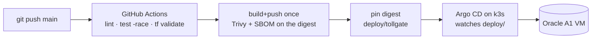

# Deploying Tollgate

Target: a single-node k3s cluster on Oracle Cloud Always Free (ARM64, 2 OCPU / 12 GB), managed by Argo CD from this repo. Expected cost: **$0/month**.



After the one-time setup below, **every merge to `main` deploys itself**. CI builds the multi-arch image once and pushes `ghcr.io/krishbansalofficial/tollgate:sha-<commit>`. Trivy and the SBOM then run against that exact published digest, for both architectures. Only then does CI pin the digest in `deploy/tollgate/kustomization.yaml`, and Argo CD syncs it. A PreSync Job runs migrations first.

## What runs on the node

| Namespace | Workload | Memory limit |
|---|---|---|
| tollgate | tollgate ×2, Postgres, Redis | 2×256 Mi + 512 Mi + 160 Mi |
| observability | OTel Collector, Tempo, Prometheus, Grafana | 256 + 512 + 768 + 256 Mi |
| argocd | Argo CD | ~1 Gi |
| kube-system / cert-manager | k3s, Traefik, CoreDNS, sealed-secrets, cert-manager | ~1 Gi |

That's about 4.5 GB at the limits, out of 12 GB.

## One-time setup (about 1 hour)

### 0. Tools

`terraform` (≥ 1.9), `kubectl`, `kubeseal` (≥ 0.41), `ssh`, `openssl`. On Windows: `winget install Hashicorp.Terraform Kubernetes.kubectl`; for kubeseal, download the Windows binary from its GitHub release.

### 1. Oracle Cloud account and API key

1. Sign up at cloud.oracle.com. A card is required for verification; Always Free resources are not charged. **Do not upgrade to Pay As You Go** unless you mean to.
2. Profile → My profile → **API keys** → Add API key → download the private key to `~/.oci/oci_api_key.pem`.
3. Copy the shown tenancy/user OCIDs, fingerprint and region into `infra/terraform/envs/oracle/terraform.tfvars` (start from `terraform.tfvars.example`; the real file is gitignored).

### 2. Provision the VM

```bash
cd infra/terraform/envs/oracle
terraform init
terraform apply          # prints public_ip and an ssh command
```

The node module **refuses** more than 2 OCPU / 12 GB / 200 GB. Exceeding the Always Free allowance on a free tenancy disables and then deletes all A1 instances.

If apply fails with `Out of host capacity`, A1 capacity in that availability domain is exhausted. Retry later or set `availability_domain_index = 1` (or 2).

cloud-init installs k3s and opens 80/443 in the host firewall. Oracle's Ubuntu images block those ports at the iptables level even when the security list allows them. The Kubernetes API (6443) is never exposed; everything goes over SSH.

### 3. Repo access for Argo CD (read-only deploy key)

```bash
ssh-keygen -t ed25519 -N "" -f ~/.ssh/tollgate_deploy_key -C argocd
gh repo deploy-key add ~/.ssh/tollgate_deploy_key.pub --title argocd   # read-only by default
```

### 4. DNS: free DuckDNS name

1. Sign in at duckdns.org and create a subdomain, e.g. `mytollgate`, pointing at the VM's `public_ip`.
2. Replace `change-me` with your subdomain in `deploy/tollgate/tollgate.yaml` and `deploy/observability/k8s/grafana.yaml`. Grafana uses `grafana.<name>.duckdns.org`, which DuckDNS resolves via its wildcard.
3. Commit and push.

The ingresses use the `letsencrypt-prod` issuer. If you're iterating on DNS, switch to `letsencrypt-staging` first to avoid Let's Encrypt rate limits.

### 5. Bootstrap Argo CD

```bash
infra/bootstrap.sh ubuntu@<public_ip> ~/.ssh/tollgate_deploy_key
```

This installs Argo CD, registers the repo using the deploy key (stored only in the cluster), and applies `deploy/argocd/root.yaml`. Argo then installs sealed-secrets, cert-manager, the issuers, observability and Tollgate, in sync-wave order.

### 6. Secrets (Sealed Secrets)

```bash
scripts/seal-secrets.sh ubuntu@<public_ip>
git add deploy/*/sealed-secrets.yaml deploy/*/kustomization.yaml
git commit -m "deploy: sealed secrets" && git push
```

The script prompts with hidden input for provider keys, a GitHub token with `read:packages` (for pulling the private image), and a Grafana password. It generates a random Postgres password and encrypts everything with the cluster's public key.

Only the encrypted files are committed: plaintext never touches disk or git. The script refuses to overwrite existing secrets, because a new Postgres password would lock the app out of the existing database. Use `FORCE=1` only for a fresh database.

### 7. First key and smoke test

```bash
ssh ubuntu@<ip> sudo k3s kubectl -n tollgate exec deploy/tollgate -- /usr/local/bin/tollgate keys create --project myapp
curl https://<name>.duckdns.org/v1/chat/completions \
  -H "Authorization: Bearer tg_..." \
  -d '{"model":"tollgate/cheapest","messages":[{"role":"user","content":"hello"}]}'
```

Grafana is at `https://grafana.<name>.duckdns.org` (user `admin`). Argo CD is reached through an SSH tunnel; `bootstrap.sh` prints the command.

## Ollama on the laptop (last-resort fallback)

The cluster reaches the laptop's Ollama over **Tailscale**, so the laptop never opens a port to the internet.

1. Install Tailscale on the laptop and on the node (`curl -fsSL https://tailscale.com/install.sh | sh && sudo tailscale up`), both in your tailnet.
2. On the laptop: `OLLAMA_HOST=0.0.0.0 ollama serve` and `ollama pull llama3.2:3b`. An 8 GB RTX 4070 runs a 3B model comfortably.
3. In `deploy/tollgate/kustomization.yaml` set:
   - `TOLLGATE_OLLAMA_BASE_URL=http://<laptop-tailnet-name>:11434/v1`
   - `TOLLGATE_FALLBACK_MODEL=ollama/llama3.2:3b`
4. Push.

When the laptop sleeps, Ollama's circuit breaker opens and the fallback fails fast instead of timing out.

## Operations

| Task | How |
|---|---|
| Deploy | merge to `main` |
| Roll back | `git revert` the `deploy: tollgate sha-…` commit |
| Revoke a key | `tollgate keys revoke --prefix tg_XXXXXXXX` (takes effect within the 30 s key-cache TTL) |
| Logs | `sudo k3s kubectl -n tollgate logs deploy/tollgate` (JSON, with `trace_id`) |
| Trace a request | paste its `X-Request-ID` into Grafana → Explore → Tempo |
| Alerts | Prometheus `/alerts` and Grafana; no Alertmanager, to keep $0 |

## Alternative host: DigitalOcean (GitHub Student Pack credit)

`infra/terraform/envs/digitalocean` builds an `s-2vcpu-4gb` droplet (amd64, ~$24/month) with the same cloud-init module. The Student Pack's $200 credit covers about 8 months.

1. Claim the DigitalOcean offer from the Student Pack page, then DO console → **API** → Generate New Token (read + write).
2. `cp terraform.tfvars.example terraform.tfvars` in that directory and fill it in.
3. `terraform init && terraform apply`, then steps 3–7 above with `root@<ip>` in place of `ubuntu@<ip>`.

The image is multi-arch, so amd64 needs no changes. **Destroy the droplet or move to Hetzner before the credit expires**, or it bills the card on file. Set a billing alert in the DO console.

## Fallback host: Hetzner (≈ €4/month)

If Oracle has no A1 capacity or changes the free tier again, `infra/terraform/envs/hetzner` builds a CAX11 (2 vCPU ARM64, 4 GB) with **the same cloud-init module**. Steps 3–7 are identical; use `root@<ip>` instead of `ubuntu@<ip>`. 4 GB fits the stack; Argo CD and Prometheus are the largest consumers.

An AWS variant would add `envs/aws` with VPC and EC2 resources and reuse `modules/k3s-cloud-init` unchanged.

## Teardown

```bash
cd infra/terraform/envs/oracle && terraform destroy
```

## Verified before first deploy

The manifests were applied to a local k3s v1.37.2 cluster (Docker) with the CI-built image:
- **Pods:** all became Ready under the pod security levels and NetworkPolicies.
- **Migrations:** applied via the Job.
- **Allowed request:** a request from the ingress namespace returned 200 through the cache, router and provider, and wrote a ledger row.
- **Blocked request:** a request from another namespace was rejected by NetworkPolicy.
- **Metrics:** Prometheus discovered both gateway pods.

That test surfaced two bugs, both fixed:
- **Invalid hostnames:** uppercase placeholder hostnames are invalid in Kubernetes.
- **Migration race:** the migration Job could lose a race with the NetworkPolicy controller on new pods. `tollgate migrate` now waits for the database with backoff.
