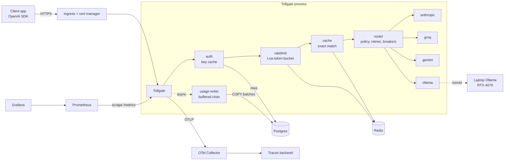
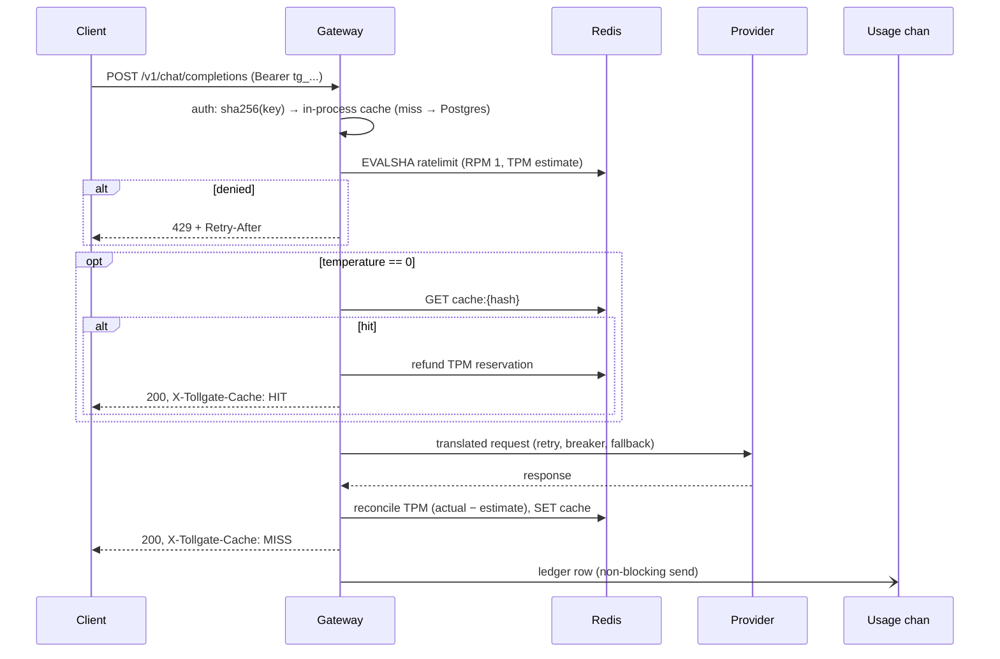

# Tollgate: Design

Status: v2 (2026-11-25). Written before the core code, then updated where the implementation diverged; those places are marked **As built**. Decisions marked **[ADR]** get their own record in `docs/adr/` when they are implemented.

## 1. Problem and goals

My apps call several LLM providers. Each provider has its own API shape, rate limits, pricing, and outages. Tollgate is one OpenAI-compatible endpoint in front of all of them. It decides who is allowed to call, how much they can call, where each call goes, and what it cost.

**Goals**

| # | Goal | Measurable target |
|---|------|-------------------|
| G1 | OpenAI-compatible `POST /v1/chat/completions`, streaming and non-streaming | The official `openai` Python/JS SDKs work by changing only `base_url` |
| G2 | Low gateway overhead | p99 overhead < 10 ms at the throughput knee, measured against a mock upstream |
| G3 | Survives provider failure | A primary provider returning 100% 5xx/429 causes no client-visible errors when a fallback exists |
| G4 | Survives dependency failure | Redis down → behaviour follows the configured fail mode; Postgres down → requests still served, ledger rows buffered and then dropped with a metric |
| G5 | Accounting | Every request has a ledger row: tokens, latency, cost, cache hit, provider, status |
| G6 | Runs for ~$0/month | Single-node k3s on Oracle Always Free ARM |

**Non-goals (MVP):** embeddings and images endpoints, tool-calling translation beyond pass-through for OpenAI-compatible providers, multi-region, a UI (stretch), and a semantic cache (stretch).

## 2. Architecture



### Request lifecycle (non-streaming)



Order rationale: auth first because nothing else should cost anything for an anonymous caller. Rate limiting runs before the cache, so cache hits still count against RPM. That bounds the Redis load a single key can cause. Cache hits are refunded their TPM reservation because they cost no upstream tokens.

## 3. Components

### 3.1 HTTP layer (`cmd/tollgate`, `internal/server`)

- Go stdlib `net/http`. The Go 1.22+ `ServeMux` supports method and path patterns (`POST /v1/chat/completions`), which covers every route here. Middleware is plain `func(http.Handler) http.Handler`. **[ADR]**
- Endpoints: `POST /v1/chat/completions`, `GET /v1/models`, `GET /healthz` (liveness: the process is up), `GET /readyz` (readiness: Redis and Postgres are reachable and providers are loaded), and `GET /metrics` on a separate port so it is never exposed through the ingress.
- Errors use the OpenAI error envelope `{"error":{"message","type","code"}}`, so SDKs surface them correctly.
- Every request carries `X-Request-ID` (generated if absent) and is echoed back. It is the trace ID.

### 3.2 Virtual keys (`internal/auth`)

- Key format: `tg_` + 32 random bytes from `crypto/rand`, base62-encoded. The first 8 characters after the prefix are stored in plain text as `key_prefix` for display and support ("key tg_a1b2c3d4… was revoked").
- **Stored as SHA-256, not bcrypt/argon2.** Password hashes are slow on purpose because passwords have low entropy. A 256-bit random key cannot be brute-forced, so a fast hash is enough. A slow hash would add ~50–100 ms to every cache-missed request. Lookup is `WHERE key_hash = $1` on a unique index. The comparison happens inside the index lookup, so there is no timing side channel on the secret. **[ADR]**
- In-process cache: `map[hash]entry` behind a `sync.RWMutex`, TTL 30 s (`TOLLGATE_KEY_CACHE_TTL`). Unknown keys are negatively cached for 5 s so a client spraying bad keys cannot hammer Postgres. Concurrent misses for the same key are collapsed with `singleflight`.
- Tradeoff: revoking a key takes up to one TTL to take effect. That is acceptable for this scale and documented. The fix at scale is a Redis pub/sub invalidation message.

### 3.3 Rate limiting (`internal/ratelimit`)

- **Token bucket**, two buckets per key: requests/min and tokens/min. A token bucket allows short bursts up to capacity while enforcing the long-run rate. That fits LLM traffic, which is bursty. A sliding-window log is exact but costs O(requests) memory per key. A fixed window lets a client send 2× the limit across a window boundary. **[ADR]**
- **One Lua script checks and updates both buckets atomically.** Redis runs a script without interleaving other commands, so the read-refill-decrement sequence cannot race across gateway replicas. That gives globally consistent limits with no distributed lock. The rule is all-or-nothing: if either bucket would go negative, neither is decremented. The script uses `redis.call('TIME')` as its clock, so gateway clock skew does not matter.
- State per bucket is a hash `{tokens, ts}` with `PEXPIRE` set to the time to refill fully, so idle keys disappear on their own.
- **The TPM problem:** output tokens are unknown before the call. The gateway reserves `estimate(prompt) + max_tokens` (or a configured default cap when `max_tokens` is absent). After the response it reconciles by adding back unused tokens. If the estimate was too low, the bucket may go negative; that "debt" delays the next request rather than failing this one.
- Prompt token estimate: `len(bytes)/4`, deliberately crude and documented. A real tokenizer per model is not worth the CPU on the hot path when the reservation is reconciled afterwards anyway.
- Denials return `429` with `Retry-After` (seconds until enough tokens refill, computed inside the script) and `X-RateLimit-Remaining-Requests/Tokens` headers.
- **Fail mode (`TOLLGATE_RATELIMIT_FAIL_MODE=open|closed`, default `open`).** Open: a Redis outage turns rate limiting off, so availability holds and spend becomes the risk. Closed: a Redis outage returns 503, so spend is protected and availability is lost. The default is open because provider-side limits and budgets still cap the damage, and a gateway that fails closed turns a cache outage into a full outage. Redis calls have a 50 ms timeout so a slow Redis cannot stall the hot path. **[ADR]**

### 3.4 Response cache (`internal/cache`)

- Exact match only. Key = `cache:v1:` + SHA-256 of a canonical JSON encoding of `{model, messages, temperature, top_p, max_tokens, stop, seed, tools, tool_choice, response_format}`. Go's `encoding/json` sorts map keys and struct fields encode in a fixed order, so the encoding is stable. The `v1` prefix lets me invalidate everything by changing the format.
- Only cacheable when `temperature` is **explicitly** 0. If it is absent, the provider default (usually 1) applies and the output is non-deterministic.
- Streaming responses are not cached in the MVP. Possible later: replay the cached completion as synthetic SSE chunks.
- `X-Tollgate-Cache: HIT | MISS | BYPASS` on every response. TTL comes from `TOLLGATE_CACHE_TTL` (default 1 h). A cache read error is treated as a miss and never fails the request.
- **As built:** the cache key is scoped per project (`cache:v1:<project>:<hash>`). A shared cache would let one tenant learn, from `X-Tollgate-Cache: HIT` or response timing, whether another tenant had sent a given prompt. Cross-project identical prompts are rare, so the hit-rate cost is small. Hits get a fresh `id`/`created`, so cached bodies can't be correlated. Hit cost savings are recorded in the ledger as `cost_saved`.

### 3.5 Providers (`internal/providers`)

```go
type Provider interface {
    Name() string
    Chat(ctx context.Context, req *api.ChatRequest) (*api.ChatResponse, error)
    ChatStream(ctx context.Context, req *api.ChatRequest) (Stream, error)
}
type Stream interface {
    Recv() (*api.ChatChunk, error) // io.EOF at end
    Close() error
}
```

- The internal canonical types (`internal/api`) **are** the OpenAI schema. Each adapter translates to and from its native API at the boundary.
- `openaicompat` adapter: Groq and Ollama both speak the OpenAI API, so one adapter with a different base URL covers both.
- `anthropic` adapter: Messages API. The system prompt is a top-level field, content is a list of blocks, `max_tokens` is required, and the SSE events are typed (`message_start`, `content_block_delta`, `message_delta`). **As built:** it pins `anthropic-version: 2026-10-21`, which rejects `temperature`/`top_p`/`top_k` on every model, so sampling parameters are not forwarded (a documented limitation).
- `gemini` adapter: native `generateContent` / `streamGenerateContent`. The role is `model` rather than `assistant`, and messages go in `contents[].parts[]`.
- All errors are normalised to `*ProviderError{Provider, Status, Retryable, RetryAfter}`. Retryable means 408, 429, 5xx, timeouts, and connection resets.
- Transport: raw `net/http` with one tuned shared `http.Transport` per provider (keep-alives, `MaxIdleConnsPerHost`), rather than vendor SDKs. **[ADR, decision pending: see §9]**
- `mock` provider plus `cmd/mockupstream`: a standalone OpenAI-compatible server with configurable latency distribution, error rate, 429 rate, and stream chunk timing. It is used by tests, load tests, and chaos tests.

### 3.6 Router (`internal/router`)

- **Model catalog** (YAML, loaded at startup): each entry maps a public model name to a provider, the native model ID, and the price per 1M input/output tokens. Aliases group equivalent models:
  - Pinned: `groq/llama-3.3-70b-versatile` goes to exactly that provider, plus the global fallback model if configured. **As built:** a pinned model must be in the catalog. An unpriced model would be served at a recorded cost of $0 and bypass spend tracking, so unknown models fail closed with 404.
  - Policy aliases: `tollgate/cheapest` and `tollgate/fastest` each hold a candidate list sorted per request.
- **cheapest**: sort candidates by estimated cost (prompt estimate × input price + max_tokens × output price).
- **fastest**: sort by an EWMA of observed latency (TTFT for streams, total for non-stream) per provider and model, α = 0.2. Each update is an atomic load and compare-and-swap on a `uint64` holding float bits, so there is no lock on the hot path.
- **Retries**: per candidate, at most `N` attempts (default 2) on retryable errors. Exponential backoff with **full jitter**: `sleep = rand[0, min(cap, base·2^attempt))`. Full jitter spreads retries from many clients so they don't re-synchronise into waves. An upstream `Retry-After` wins if it is longer. Retries stop at the request's context deadline.
- **Retry budget**: retries may not exceed 20% of requests over a rolling window. Without a budget, a provider brown-out multiplies load by the retry count exactly when the provider is weakest.
- **Circuit breaker per provider**, implemented in-house (~80 lines, mutex-guarded state machine) because I need to explain every transition:
  - Closed → Open when failures in a 10 s rolling window are at least 5 and the failure ratio is at least 50%.
  - Open → Half-open after a cooldown of 15 s, doubling up to 2 min while failures continue.
  - Half-open admits one probe. Success closes the breaker; failure re-opens it.
  - An open breaker makes the router skip that provider instantly, without waiting for a timeout.
  - 429s count toward the breaker: with the gateway's shared provider key they mean quota exhaustion. **As built:** client-fault responses (400/404/413/422) are neutral. They neither count as success nor close a half-open breaker, so bad requests can't mask a failing provider. Gemini's 400 for an invalid API key is reclassified as 401 so it fails over.
- **Fallback**: on a non-retryable error, or once retries are exhausted, move to the next candidate. Ollama is always appended last when `TOLLGATE_OLLAMA_FALLBACK=true`. 4xx errors that are the client's fault (400 invalid request, 413) are returned immediately with no fallback, because another provider would reject them too.

### 3.7 Streaming

- The gateway rewrites upstream chunks into OpenAI `chat.completion.chunk` SSE and flushes through `http.Flusher` after every event. Writes have a deadline via `http.ResponseController` so a stalled client cannot pin a goroutine forever.
- **TTFT** = time from request receipt to the first chunk with non-empty content written to the client. It is recorded in a histogram and on the span.
- **Retries and fallback apply only before the first byte reaches the client.** After that, the response status and partial content are committed. A mid-stream upstream failure emits an OpenAI-style error event, then `data: [DONE]`, and the ledger records `status=stream_interrupted`.
- Client disconnect: `r.Context()` is cancelled, which cancels the upstream request, so the provider stops generating and we stop paying. The ledger records the partial tokens.
- Usage in streams: request `stream_options.include_usage` (OpenAI-compatible providers), read `message_delta.usage` (Anthropic), or read `usageMetadata` (Gemini). If usage is missing, fall back to the estimate and mark `usage_estimated=true`.

### 3.8 Usage ledger (`internal/usage`)

- The hot path does a **non-blocking send** (`select { case ch <- row: default: dropped.Inc() }`) into a buffered channel (cap 10,000). If the buffer is full, the row is dropped and a metric is incremented. The request is never slowed. Losing an accounting row is better than adding Postgres latency to the response. The drop counter has an alert, so loss is visible, never silent. **[ADR]**
- A single writer goroutine batches up to 500 rows or 1 s, whichever comes first, and inserts them with pgx `CopyFrom` (Postgres `COPY`, roughly 10× faster than multi-row `INSERT`). On insert failure it retries with backoff 3 times, then drops and counts.
- **Graceful shutdown**:
  1. Stop accepting connections and drain in-flight HTTP requests with `srv.Shutdown(ctx)`.
  2. Only then close the channel. No handler can send on a closed channel because all handlers have returned.
  3. The writer drains the remainder, flushes, and signals done.
  4. Bounded by `terminationGracePeriodSeconds`.
- Rows: request ID, project, key ID, model, provider, tokens in/out, `usage_estimated`, latency total, upstream latency, TTFT, cost (USD, `numeric(12,6)`), cost saved, cache status, HTTP status, error class, and timestamp.

### 3.9 Observability (`internal/telemetry`)

- **Traces**: OTel SDK with an OTLP/gRPC exporter to the collector. Spans: `gateway.request` (root), `auth`, `ratelimit`, `cache.get`/`cache.set`, `router`, one `provider.attempt` per try (attributes: provider, model, attempt, status, retryable), and `stream.first_token` as an event. **As built:** the SDK head-samples at 1.0, and the collector's tail sampling keeps every error trace, every trace over 2 s, and 10% of the rest. Head sampling below 1.0 would drop error traces before the collector saw them.
- **Metrics**: `prometheus/client_golang` directly rather than OTel metrics through the collector. It has fewer moving parts and native histograms. **[ADR]**
  - `tollgate_requests_total{route,status,provider,cache}`
  - `tollgate_provider_errors_total{provider,class}`
  - `tollgate_overhead_seconds` histogram = total − upstream time. This is the G2 metric.
  - `tollgate_ttft_seconds{provider}`, `tollgate_upstream_seconds{provider}`
  - `tollgate_cache_requests_total{result}` gives the hit rate.
  - `tollgate_cost_usd_total{project}`. Cost per project per day = `increase(...[1d])`.
  - `tollgate_ratelimit_decisions_total{result}`, `tollgate_breaker_state{provider}`, `tollgate_usage_dropped_total`, `tollgate_usage_buffer_len`
  - Cardinality rule: labels only from bounded sets (project, provider, catalog model). Never the key ID, user, or raw model string.
- **Logs**: `log/slog` JSON handler, wrapped so every record gets `trace_id`/`span_id` from the context. One access log line per request. Prompts and completions are never logged.

### 3.10 Config (`internal/config`)

Env vars only, parsed once into a typed struct at startup, failing fast on invalid values. The catalog YAML path is itself an env var. No config hot-reload in the MVP; a restart in k8s takes about a second.

## 4. Data model

```sql
projects   (id uuid pk, name text unique, monthly_budget_usd numeric, rpm_limit int, tpm_limit int, created_at)
api_keys   (id uuid pk, project_id fk, key_hash bytea unique, key_prefix text, name text,
            rpm_limit int null, tpm_limit int null,   -- null = inherit from project
            revoked_at timestamptz null, created_at, last_used_at)
usage_events (id bigserial, ts timestamptz, request_id text, project_id, key_id, model, provider,
              tokens_in int, tokens_out int, usage_estimated bool, latency_ms int, upstream_ms int,
              ttft_ms int null, cost_usd numeric(12,6), cost_saved_usd numeric(12,6),
              cache text, status int, error_class text null)
              -- index (project_id, ts); BRIN on ts
```

Migrations use goose with embedded SQL files, run by a `tollgate migrate` subcommand (a k8s Job run as an Argo CD Sync hook in wave 1, after the secret and Postgres in wave 0 and before the Deployment in wave 2; a PreSync hook deadlocks the first deploy because it runs before the secret exists). They are not run on every pod start, which would race with multiple replicas.

Key management for the MVP is a CLI: `tollgate keys create --project X` prints the raw key **once**.

## 5. Failure modes

| Failure | Behaviour | Detected by |
|---|---|---|
| Redis down | Rate limit follows fail mode; cache bypassed; `/readyz` stays ready in open mode | `tollgate_ratelimit_decisions_total{result="error"}`, Redis exporter |
| Postgres down | Cached keys keep working, uncached keys get 503; ledger buffers then drops | `tollgate_usage_dropped_total`, `/readyz` |
| Provider 429/5xx | Retry → breaker → fallback | `tollgate_provider_errors_total`, breaker state |
| Provider slow | Per-attempt timeout (non-stream) or first-byte timeout (stream) → fallback | `tollgate_upstream_seconds` |
| Pod killed mid-stream | In-flight streams cut, client sees a truncated stream; SIGTERM path drains new work and flushes the ledger | chaos test |
| Laptop (Ollama) offline | Breaker opens, so the last-resort fallback fails fast | breaker metric |

## 6. Deployment

- **Target:** Oracle Cloud Always Free, `VM.Standard.A1.Flex` (ARM64). Per reports from June 2026 the Always Free A1 allowance was halved to **1,500 OCPU-hours and 9,000 GB-hours per month, i.e. 2 OCPU / 12 GB running 24/7**. Oracle's own docs page still showed the old figures when I checked, so Terraform defaults to **2 OCPU / 12 GB** and must never exceed that. Exceeding the allowance disables, then deletes, all A1 instances on a free tenancy. A Terraform `validation` block enforces the cap.
- Memory budget (requests): k3s ~600 MB, Argo CD ~700 MB (core install, no Dex, no notifications), Prometheus ~600 MB (7 d retention), Postgres 512 MB, Grafana 200 MB, OTel Collector 150 MB, Redis 128 MB, Tollgate 2× 64 MB. That is about 3 GB, leaving plenty of headroom.
- Idle reclamation risk: Oracle may reclaim Always Free instances that sit idle for long periods. Real traffic and the k8s control plane keep utilisation up. This is documented as a risk.
- Traces backend: Grafana Tempo (single binary, local storage) so traces are viewable in the same Grafana.
- Ingress: k3s's bundled Traefik plus cert-manager with Let's Encrypt HTTP-01. Domain: a free subdomain (DuckDNS or similar) unless you have one.
- Secrets: Sealed Secrets. The controller's public key encrypts secrets into a `SealedSecret` that is safe to commit. No external secret store is needed, so it stays $0. **[ADR]**
- Ollama on the laptop is reached through a Tailscale tailnet (free tier), so the laptop needs no open ports. When the laptop sleeps, the breaker handles it.
- Fallback host: Hetzner CAX11 (2 vCPU ARM, 4 GB). It is **not** free (about €4/month); it is documented as the escape hatch, and the same Terraform root module works with a different provider module.
- Terraform layout: `infra/terraform/modules/{network,k3s-node}` are cloud-agnostic in interface (inputs: shape, ssh key, cloud-init; outputs: public IP). `envs/oracle` wires them to OCI resources. An `envs/aws` variant later swaps the module implementations. k3s is installed via cloud-init, so the module output is a working cluster.

## 7. What changes at 100× scale

- **Rate limiting:** Redis Cluster, with keys hash-tagged `{key_id}` so both buckets for a key land on one shard and the script stays atomic. A local pre-check (in-process token bucket at 1/N of the limit) cuts Redis round trips.
- **Auth cache invalidation** via pub/sub instead of TTL.
- **Ledger:** the channel becomes a durable queue (Kafka or Redpanda) so a pod crash loses nothing. Postgres becomes ClickHouse or time-partitioned Postgres with rollups.
- **Breaker and EWMA state** stay per-replica, which is fine because each replica observes the same upstream. Shared state would add a dependency to the hot path.
- **Streaming:** connection count rather than CPU becomes the limit. Tune the file-descriptor limits and the HTTP/2 upstream connection pool.

## 8. Testing strategy

- Unit tests per package, table-driven: translation golden files per provider, canonical cache-key stability, backoff bounds, breaker transitions with an injected clock, and cost math.
- Integration tests with testcontainers-go: the Lua script against real Redis, migrations and `CopyFrom` against real Postgres.
- A concurrency test: 200 goroutines hammer one key whose limit is N; assert exactly N are admitted. Run under `-race`.
- End-to-end: gateway → `mockupstream` with error injection, covering retry, breaker, fallback, and stream interruption.
- CI: `go vet`, `golangci-lint` (includes staticcheck), and `go test -race`.

## 9. Decisions (2026-11-24)

1. **Provider transport:** raw `net/http`. Vendor SDKs have their own built-in retries that would conflict with the router's retry and breaker logic.
2. **Deploy packaging:** Kustomize plain manifests. CI bumps the image tag with `kustomize edit set image`.
3. **First real provider:** Groq (Phase 1), then Anthropic (Phase 2) and Gemini (Phase 5).
4. **Domain:** a free DuckDNS subdomain with Let's Encrypt HTTP-01.
